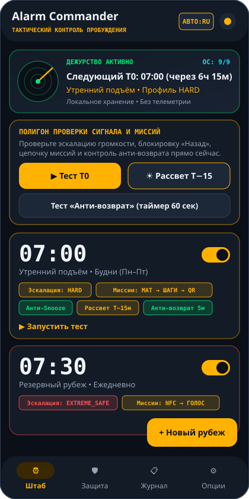
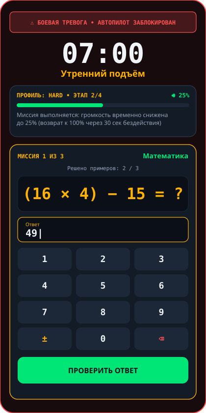
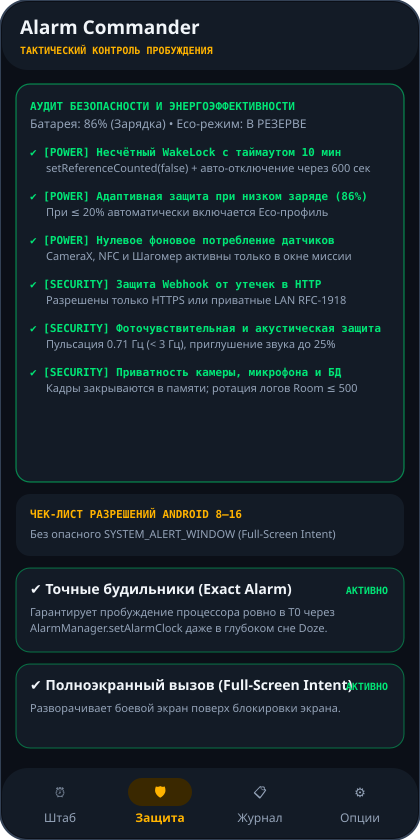
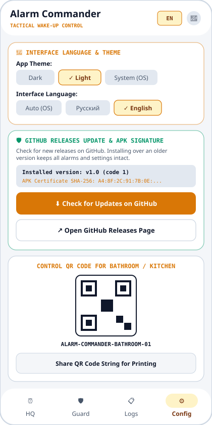

# Alarm Commander — Многослойный тактический будильник / Multi-Layered Tactical Wake-Up System (Android)

> **[RU]** Надёжный Android-будильник с открытым исходным кодом (Kotlin + Jetpack Compose + Material 3), который не даёт выключить себя «на автопилоте» во сне. Использует 4-ступенчатую эскалацию сигнала, цепочки физических и когнитивных миссий, контроль «Анти-возврат в кровать» и локальные резервные каналы. Без рекламы, аналитики и облачной слежки.  
> **[EN]** Open-source tactical Android alarm application (Kotlin + Jetpack Compose + Material 3) designed to prevent unconscious dismissal on autopilot. Features 4-stage sound & vibration escalation, physical & cognitive mission chains, Anti-Return-to-Bed verification, and local smart-home/contact backup channels. 100% local, ad-free, and zero telemetry.

---

## 🇷🇺 О ПРИЛОЖЕНИИ (РУССКИЙ)

### Скриншоты интерфейса
| Штаб и тактический радар | Боевая тревога и миссия «Математика» |
| :---: | :---: |
|  |  |
| **Защита и энергоаудит (Android 8–16)** | **Опции, светлая тема и QR-генератор (EN)** |
|  |  |

### Зачем нужен Alarm Commander?
Обычные будильники легко выключить одним смахиванием, не просыпаясь до конца, или отложить кнопкой Snooze и снова уснуть. **Alarm Commander** решает эту проблему комплексно: чтобы отключить сигнал, необходимо физически встать с кровати и пройти заданную цепочку проверок, а спустя несколько минут — подтвердить, что вы не легли обратно.

### Как работает система пробуждения по шагам
1. **Фаза «Рассвет» (`T−15 минут`)**:
   - За 15 минут до основного сигнала экран смартфона плавно включает тёплое янтарное свечение, а при наличии умного дома отправляется локальный запрос (Webhook) на включение умной лампы в спальне.
   - Если вы проснулись раньше — фазу рассвета можно завершить одной кнопкой.
2. **Точный сигнал в `T0` (`AlarmManager.setAlarmClock`)**:
   - Будильник выводит смартфон из глубокого сна (Doze Mode), включает полноэкранный режим поверх блокировки экрана и блокирует системную кнопку/жест «Назад».
3. **4-ступенчатая эскалация звука и вибрации**:
   - Доступны 3 профиля: **Gentle** (плавный старт), **Hard** (тактический) и **ExtremeSafe** (быстрый выход на максимум).
   - Если нет реакции в течение 20–45 секунд, громкость пошагово растёт до 100%, уплотняется ритм вибрации и подключается двухтональная сирена.
   - **Комфорт во время миссии**: как только вы начинаете выполнять миссию, звук автоматически приглушается до **25%**, чтобы не мешать считать или сканировать код. Если перестать выполнять задание на 30 секунд — полная громкость вернётся.
4. **Цепочка миссий для отключения (от 1 до 5 заданий подряд)**:
   - **Математика (`MATH`)**: решение от 3 до 5 арифметических примеров (3 уровня сложности) на встроенной крупной цифровой клавиатуре.
   - **Шагомер (`STEPS`)**: необходимо пройти от 20 до 100 реальных шагов по квартире (используется аппаратный датчик шагов смартфона).
   - **QR-код в ванной (`QR`)**: сканирование камерой распечатанного QR-кода, размещённого в ванной или на кухне.
   - **NFC-метка (`NFC`)**: касание смартфоном NFC-метки в другой комнате.
   - **Голосовая фраза (`VOICE`)**: произнесение вслух контрольной фразы пробуждения.
5. **Анти-Snooze и штрафной перенос (Penalty-Snooze)**:
   - По умолчанию кнопка «Отложить» полностью отключена.
   - Если в настройках будильника включён «Штрафной Snooze», для отсрочки на 5 минут потребуется без единой ошибки ввести с клавиатуры длинную контрольную фразу.
6. **Контроль «Анти-возврат в кровать»**:
   - Через 5 минут после отключения будильника запускается 60-секундное окно проверки бодрствования. Если не подтвердить, что вы на ногах — боевая тревога и цепочка миссий запустятся заново.
7. **Резервные каналы при просрочке (Overdue)**:
   - Если будильник не выключен за отведённое время, приложение может автоматически вызвать локальный Webhook умного дома (например, включить верхний свет через Home Assistant) и вывести экстренное уведомление для связи с резервным контактом.

---

### Установка и настройка (RU)

#### 1. Как установить и обновлять приложение
1. Перейдите в раздел **[Releases](../../releases)** этого репозитория на GitHub и скачайте последний файл `.apk`.
2. Установите APK на свой Android-смартфон (Android 8.0 и новее).
3. **Обновление до новых версий**:
   - Вы можете проверять выход новых версий прямо внутри приложения: откройте вкладку **Опции → Обновление через GitHub** и нажмите **«Проверить обновления на GitHub»**.
   - Скачайте новый APK со страницы релизов и установите его **поверх текущей версии** (удалять старую версию не нужно — все ваши будильники, QR-коды и настройки сохранятся).

#### 2. Первоначальная настройка после установки
1. **Вкладка «Защита» (Разрешения Android)**:
   - Выдайте разрешения **«Точные будильники»**, **«Полноэкранный вызов»** и **«Экстренные уведомления»**.
   - Рекомендуется добавить приложение в **«Исключения из экономии заряда»**, чтобы оболочка смартфона (Xiaomi HyperOS/MIUI, Samsung OneUI и др.) не останавливала будильник ночью.
   - Выдайте доступ к камере, шагомеру или микрофону, если планируете использовать соответствующие миссии.
2. **Вкладка «Опции» (Тема, Язык, QR-код и Умный дом)**:
   - Выберите удобную тему (**Тёмная**, **Светлая** или **Авто**) и язык интерфейса (**Авто**, **Русский** или **English**) — переключатели также доступны на верхней панели.
   - В карточке **«Контрольный QR-код для ванной / кухни»** нажмите кнопку отправки, распечатайте QR-код и приклейте его в ванной комнате.
   - При желании укажите локальные адреса Webhook вашего умного дома (Home Assistant) и номер резервного контакта.
3. **Вкладка «Штаб» (Создание и проверка рубежа)**:
   - Нажмите **«Новый рубеж»**, выберите время, дни недели, профиль эскалации и цепочку миссий.
   - Используйте блок **«Полигон проверки сигнала и миссий»** (`Тест T0`, `Рассвет T−15`, `Тест «Анти-возврат»`), чтобы заранее протестировать звук, камеру и шагомер.

> **Предупреждение о безопасности**: Приложение является вспомогательным инструментом дисциплины пробуждения, **не гарантирует пробуждение на 100%** и **не является медицинским устройством**. В приложении намеренно исключены любые опасные для здоровья методы (высокочастотные стробоскопы, скрытая запись, передача личных данных).

---

## 🇬🇧 ABOUT THE APPLICATION (ENGLISH)

### Application Screenshots
| Command Center & Tactical Radar | Combat Alarm & Math Mission |
| :---: | :---: |
|  |  |
| **Security & Power Audit (Android 8–16)** | **Config, Light Theme & QR Generator (EN)** |
|  |  |

### Why Alarm Commander?
Standard alarms are easy to swipe away while half-asleep or snooze indefinitely. **Alarm Commander** eliminates autopilot dismissal: to silence the alarm, you must physically get out of bed, complete a customizable chain of physical and cognitive missions, and pass an **Anti-Return-to-Bed** check minutes later.

### How the Wake-Up Pipeline Works
1. **Sunrise Pre-Alarm (`T−15 minutes`)**:
   - 15 minutes before the main alarm, the screen gradually illuminates with a warm dawn gradient and optionally triggers a local Smart Home Webhook (e.g., Home Assistant smart bulb).
2. **Exact Wake-Up at `T0` (`AlarmManager.setAlarmClock`)**:
   - Wakes the device from deep Doze mode, launches a high-priority foreground service over the lockscreen, and locks the system Back button/gesture.
3. **4-Stage Sound & Vibration Escalation**:
   - Choose between **Gentle**, **Hard**, and **ExtremeSafe** profiles.
   - If unacknowledged within 20–45 seconds, volume progressively ramps up to 100%, vibration cadence intensifies, and a dual-tone siren engages.
   - **Mission Volume Attenuation**: Once you start solving a mission, alarm volume automatically drops to **25%** so you can focus, and restores to **100%** if you stop interacting for 30 seconds.
4. **Unlock Mission Chains (1 to 5 sequential tasks)**:
   - **Math (`MATH`)**: Solve 3–5 arithmetic equations (`Easy`, `Medium`, `Hard`) using the built-in lockscreen tactical Numpad.
   - **Step Counter (`STEPS`)**: Walk 20–100 physical steps measured by the hardware step sensor.
   - **Bathroom QR (`QR`)**: Scan a printed QR code placed in your bathroom or kitchen.
   - **NFC Tag (`NFC`)**: Tap your phone against a registered NFC tag away from your bed.
   - **Voice Phrase (`VOICE`)**: Speak a verification phrase aloud.
5. **Anti-Snooze & Penalty-Snooze**:
   - Snooze is disabled by default. If Penalty-Snooze is enabled in the alarm settings, postponing the alarm by 5 minutes requires typing a full verification sentence without typos.
6. **Anti-Return-to-Bed Verification**:
   - 5 minutes after completing all missions, a 60-second readiness check triggers. If you do not confirm that you are awake, the full `T0` alarm and mission chain restart automatically.
7. **Overdue Backup Channels**:
   - If the alarm is not dismissed within the safety window, the app can trigger an Overdue Smart Home Webhook and display a quick-action alert for your backup contact.

---

### Installation & Setup Guide (EN)

#### 1. Installing & Updating from GitHub Releases
1. Go to the **[Releases](../../releases)** page of this repository and download the latest `.apk` file.
2. Install the APK on your Android device (Android 8.0+).
3. **In-Place Updates**:
   - You can check for new releases directly inside the app under **Config → GitHub Releases Update** by tapping **"Check for Updates on GitHub"**.
   - Download the new APK from the Releases page and install it **directly over your existing installation**—all your alarms, logs, and settings are preserved automatically.

#### 2. Initial Configuration
1. **Guard Tab (Permissions)**:
   - Grant **Exact Alarms**, **Full-Screen Intent**, and **High-Priority Notifications**.
   - Enable **Unrestricted Battery** so aggressive OEM battery savers do not terminate the alarm overnight.
   - Grant Camera, Physical Activity, or Microphone permissions for the missions you use.
2. **Config Tab (Theme, Language, QR Code & Smart Home)**:
   - Switch between **Dark**, **Light**, or **System** theme and select **Auto (OS)**, **Русский**, or **English** language (also accessible right from the top bar).
   - Generate and share your **Control QR Code** to print and place in your bathroom or kitchen.
   - Optionally configure local Smart Home Webhook URLs (`https://` or local `192.168.x.x` / `10.x.x.x` LAN) and a backup contact.
3. **HQ Tab (Create & Test Alarms)**:
   - Tap **"New Alarm"** to configure time, days of week, escalation profile, and mission chain.
   - Use the **Signal & Mission Proving Ground** (`Test T0`, `Sunrise T−15`, `Test Anti-Return`) to test your setup anytime.

> **Safety Disclaimer**: Alarm Commander is a supplementary wake-up discipline tool, **does not guarantee 100% wake-up**, and is **not a medical or life-support device**. All data is stored strictly on-device.
